# Blockyland

**A Minecraft-inspired voxel game built so that making things with AI is easy and fun.**

Blockyland shares most of what makes Minecraft great: endless worlds, survival and creative modes, crafting, redstone and dozens of mobs. It runs entirely in your browser, with nothing to install. What sets it apart is that AI is built in everywhere:

- **Agent Terminal:** describe what you want built or changed in the world, in plain words.
- **Multiplayer:** share your world with a link, without running a server.
- **Mods:** make new games with an AI coding assistant.
- **Building Studio:** design large structures with AI and export them as WorldEdit `.schem` files.
- **Movies:** make short films out of blocks.

**▶ Play it now at [blockyland.online](https://blockyland.online)**, or run it yourself with `npm install && npm run dev`.

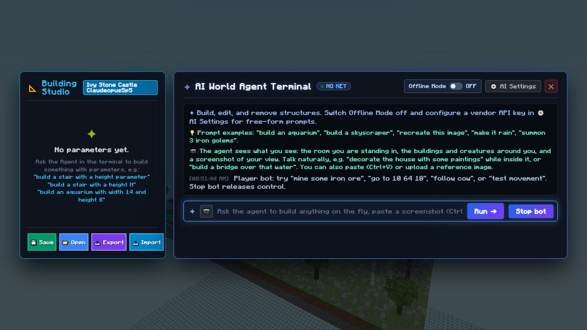

---

## Contents

- [What you can do](#what-you-can-do)
  - [1. Play in the browser, and change the world by talking to it](#1-play-in-the-browser-and-change-the-world-by-talking-to-it)
  - [2. Host a multiplayer world with no server](#2-host-a-multiplayer-world-with-no-server)
  - [3. Make mods with AI](#3-make-mods-with-ai)
  - [4. Design big builds in Building Studio and export them as .schem](#4-design-big-builds-in-building-studio-and-export-them-as-schem)
  - [5. Make movies out of blocks](#5-make-movies-out-of-blocks)
- [Getting started](#getting-started)
- [Under the hood](#under-the-hood)
- [Testing](#testing)
- [Repository layout](#repository-layout)
- [Documentation index](#documentation-index)
- [Known limits](#known-limits)

---

## What you can do

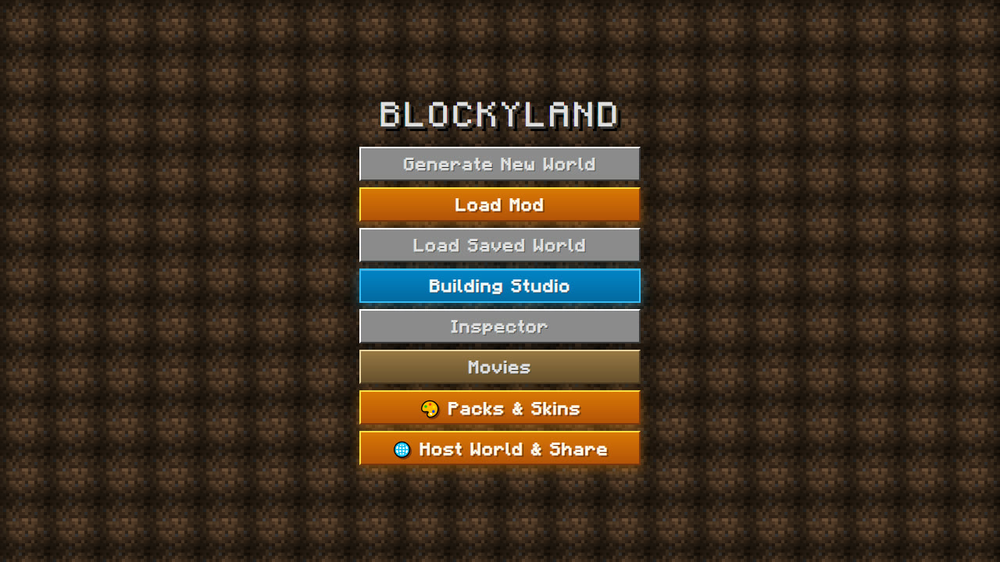

Everything starts from one screen. Each button below leads to one of the features in this section.

### 1. Play in the browser, and change the world by talking to it

**The game.** Blockyland is a complete sandbox game in a browser tab:
- **Worlds:** seeded worlds with many biomes, caves, oceans and coral reefs. Villages, outposts, ancient cities, bastions, mansions, monuments, trial chambers, shipwrecks and more are generated from the same rules Minecraft uses.
- **Survival:** hunger, crafting, smelting, brewing, enchanting, anvils, smithing, villager trading, raids, farming, fishing, beds, elytra, beacons, Nether and End portals, and boss fights.
- **Mobs:** a large roster of animals, monsters, villagers, golems and bosses, each with its own behavior, plus natural spawning driven by light and time of day.
- **Creative mode:** flying, every block, game rules and `/give`-style commands.
- **Water and redstone:** flowing water with buckets and currents, redstone, and rails.
- **Looks:** colored block lights with shadows, an optional shader, and resource packs and skins.

**The Agent Terminal.** Turn on **Cheats** (they are on by default in Creative), then press **C**. A terminal opens where you tell an AI agent what you want in plain language:

- “Build a lighthouse overlooking the water.”
- “Replace its stone walls with brick, but keep the windows.”
- “Bridge that gap in front of me.”
- “Summon 3 iron golems.” “Make it rain.” “Decorate this house with paintings.”
- “Destroy the lighthouse.”

| Asking the agent | The result in the world |
|---|---|
| 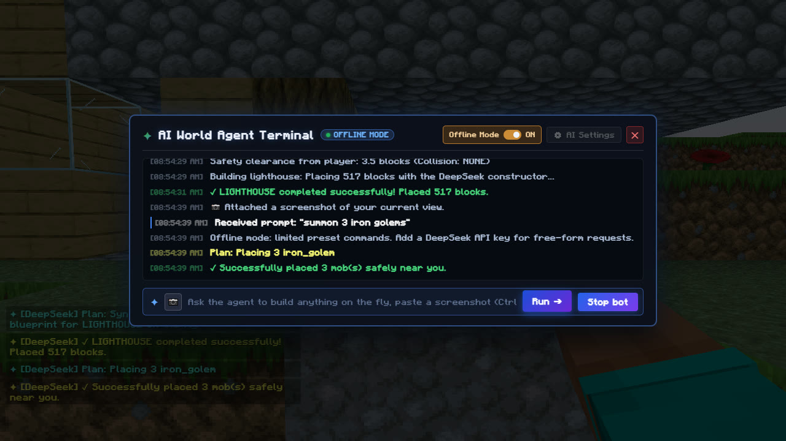 | 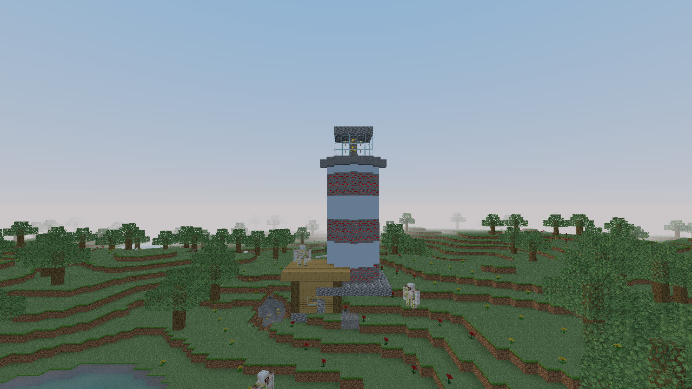 |

**The agent sees what you see.** Each request includes the terrain around you, the buildings and creatures nearby, the room you are standing in, and a screenshot of your view. So "that gap" and "this house" mean what you'd expect. You can also paste or upload a reference image ("recreate this image").

**You choose the model.** Open **⚙️ AI Settings** and pick Claude, ChatGPT, Gemini or DeepSeek, a model and an API key. Requests go straight from your browser to that provider, with no proxy in between. **Offline Mode** uses a set of built-in presets instead, so you can try the terminal without a key. The screenshots above were taken in Offline Mode.

**It's safe by design.** The agent returns a plan made of the game's own actions, and the game checks the plan before carrying it out. Code written by the model is never run. Every structure remembers the blocks it replaced, so "destroy it" restores the ground while keeping your own later edits.

The same terminal also drives a **player bot**, which needs no key: `mine 8 coal ore`, `go to 10 64 10`, `follow cow`, `attack zombie`. See [`docs/player-bot.md`](docs/player-bot.md).

<details>
<summary><b>How API keys are stored</b></summary>

- **Use for session** keeps a key only in this page's memory. Reloading the page or choosing **Lock / forget session** removes it.
- **Remember key (encrypted)** saves the key in your browser:
  - It is encrypted with your passphrase (12+ characters) using AES-256-GCM and PBKDF2-SHA-256 with 600,000 iterations.
  - Only the encrypted copy is stored. Saved keys start locked, so you unlock them with the passphrase each session.
  - **Delete key** removes the saved key.
- Encryption protects the saved copy while it is locked. While a key is unlocked, it can be read by:
  - other scripts on the page and trusted mods
  - browser extensions
  - malware
- **Best practice:** use a dedicated key with an expiry date and a small hard spending limit, and revoke it at the provider when you're done. Deleting a key locally doesn't revoke it.

`npm run test:agent:vault` and `npm run test:agent:vault:browser` cover key storage. They use fake credentials and block real provider requests.
</details>

### 2. Host a multiplayer world with no server

Click **🌐 Host World & Share** on the start screen, or **Share This World** in the pause menu. You get a link to send to friends. When they click it, they're in your world. Nobody installs anything, makes an account or runs a server: **your browser is the server**, and friends connect to it directly, peer to peer.

1. **Start or load a world, then share it.** The dialog shows a link like `https://blockyland.online/?join=ewb4b42j`, the 8-character world code and everyone in the world. The host is marked ★.

   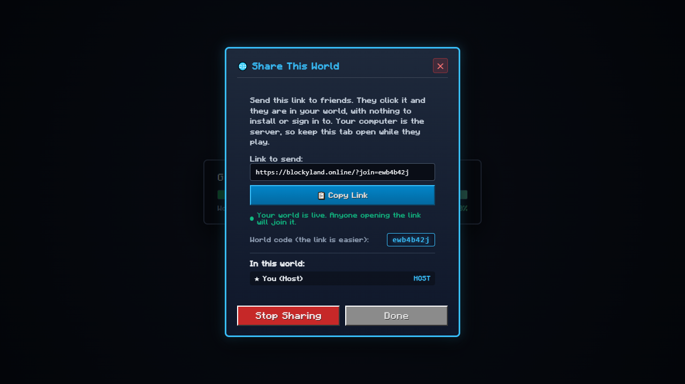

2. **Send the link** by chat, email or text.
3. **Your friend clicks it.** Their browser connects to yours, downloads a copy of your world and drops them in next to you.
4. **Play together.** Each of you sees the other with a name tag, and a badge shows how many players are in the world.

   | The host's view | The friend's view |
   |---|---|
   | 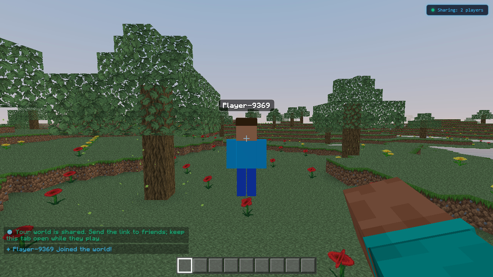 | 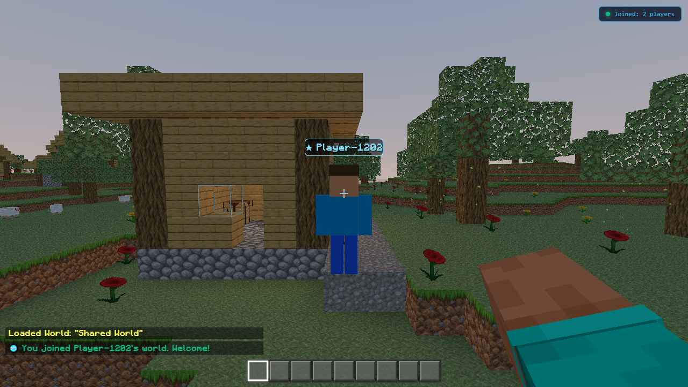 |
   | *"Sharing: 2 players"* · *"Player-9369 joined the world!"* | *"Joined: 2 players"* · *"You joined Player-1202's world. Welcome!"* |

   These come from a real session on blockyland.online, with two separate browsers standing five blocks apart.

5. **Stop Sharing** when you're done. Friends are told the world closed, and each of them can still save their copy.

**How it works**

```
 friend's browser          introduction service             your browser (the host)
        | -- "join ewb4b42j" ----> |                                  |
        | -- connection offer ---> | ------------------------------->  |
        | <---------- answer ----- | <-------------------------------  |
        | <=========== direct WebRTC connection, peer to peer =======> |
        | <------------------------------ your world (gzipped, once) - |
        | <---------- blocks, movement, held items, chat (live) -----> |
```

- **The host is the authority.** Your browser holds the world. It gives each guest an identity, checks every message they send and relays the valid ones. Up to 8 players can be in a world.
- **A small introduction service only helps browsers find each other.** It never carries gameplay, never sees the world and keeps no list of rooms. On blockyland.online it runs on Cloudflare (a Pages Function and a Durable Object). Locally, the dev server includes it.
- **The world is sent once,** gzipped (under 1 MB for a default world). A friend usually connects in about 2 seconds and has the world in about 3.
- **What's shared:**
  - **Live:** block edits, players' movement and held items, chat, and who joins and leaves.
  - **Separate on each computer:** mobs, dropped items, redstone, fluids, crops, the clock, chests, and each player's inventory.
- **Guest messages are validated and rate-limited.** World codes have 40 bits of randomness, so they can't be guessed. Anyone with the link can join until you stop sharing, and there's no kick yet.

```sh
npm run dev      # friends on the same Wi-Fi: the share dialog lists network links they can open
npm run share    # build and serve the game plus the introduction service, for a tunnel or a server
npm run share:check -- https://your-address   # two real browsers host, join and edit in both directions
```

Full details, including blocked networks, TURN relays and every join error, are in [`docs/sharing.md`](docs/sharing.md).

### 3. Make mods with AI

A mod is a whole game in one folder: `src/mods/<id>/`. The folder holds a `mod.json` manifest and its own rules, maps, models, UI and sounds. The engine handles chunks, rendering, physics, input, saving and multiplayer sessions. That means a mod is mostly game design, which is exactly what an AI coding assistant is good at.

Writing a mod with AI:
1. Describe the game you want to an assistant such as Claude Code, and point it at [`docs/creating-mods.md`](docs/creating-mods.md) and [`docs/mod-api.md`](docs/mod-api.md).
2. It creates the folder, the `mod.json` manifest and a `createGame()` rules factory.
3. `npm run mods:generate` checks the manifest and adds the mod to the **Load Mod** menu.
4. `npm run test:mods` checks it against the engine.

A game mod's rules never touch the screen directly. They run in a Web Worker for local play, or on a Node host online, and send back scene descriptions for the engine to draw. Everything a mod registers is namespaced, and closing it removes all of it, so the base game is left as it was.

| The Load Mod menu | Voxel Dash: a rhythm platformer |
|---|---|
| 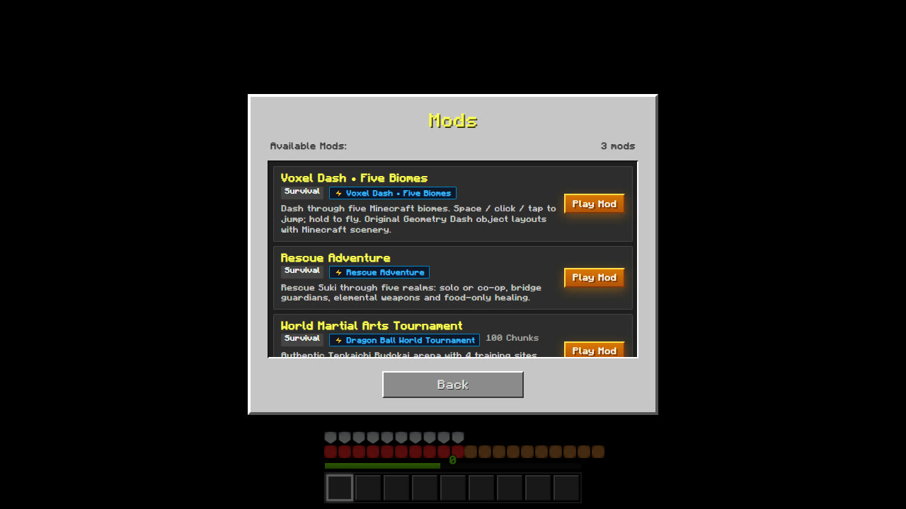 | 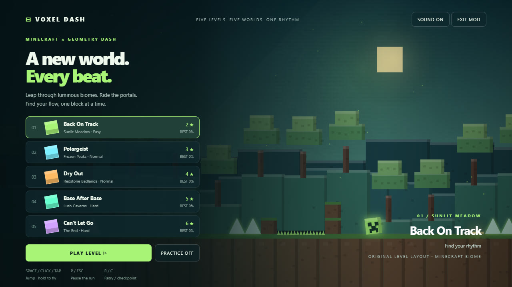 |
| **Voxel Dash in play** | **Rescue Adventure: a co-op campaign** |
| 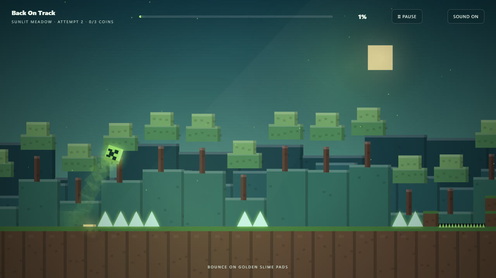 | 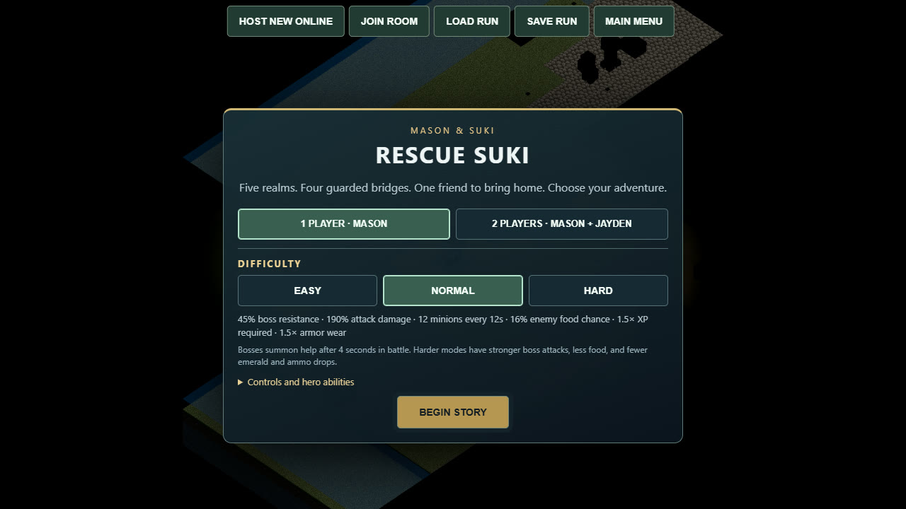 |

The three bundled mods show how different a mod can be from the base game:
- **Voxel Dash:** five Geometry Dash-style levels set in biomes, with 240 Hz physics.
- **Rescue Adventure:** a five-realm co-op campaign with bosses and elemental weapons, ported from a standalone browser game.
- **World Martial Arts Tournament:** an arena with Ki skills and a dungeon mode.

Mods are trusted code that is part of the build, not a sandbox for downloaded code. See [`docs/mod-system.md`](docs/mod-system.md).

### 4. Design big builds in Building Studio and export them as .schem

**Building Studio** is an empty sky world with an invisible grid floor, made for designing structures. Open the Agent Terminal there (**C**) and ask for something like:
- “Build a stair with a height parameter.”
- “Build an aquarium with width 14 and height 8.”

The AI writes the building as a small generator. Each parameter becomes a slider in the **Building Studio** panel, and the building rebuilds live as you drag. Your designs are saved to a library, so you can place them in any world.

| Building Studio panel and Agent Terminal | The castle, from above |
|---|---|
|  |  |

**📤 Export** saves the open building as a **WorldEdit-compatible Sponge `.schem` file**, ready for Minecraft Java with WorldEdit, or for any other tool that reads schematics. **📥 Import** loads one or more `.schem` files into your library.

The castle above is `ivy_stone_castle_claudeOpus5p5.schem`, built with Claude Opus 5.5. It is 124 × 62 × 116 blocks (144,053 blocks in all), with ivy-covered walls, towers, a moat, gardens and farm plots, and it opens in the Studio in seconds. The `.schem` reader and writer live in `src/io/`, alongside vanilla structure NBT support and a `.mcworld` exporter.

### 5. Make movies out of blocks

Blockyland can stage, voice, score and film short animated movies in its own block world. Each film on the **Movies** page was made from **a single prompt**, which you can read under "See the prompt". From that prompt, an AI wrote the script, built the sets from the game's blocks, cast and animated the characters, generated a distinct voice for each one, composed the score, added Chinese and English subtitles, and rendered the film.

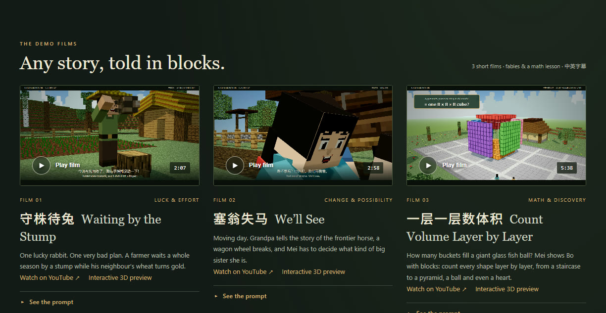

| Film | What it shows |
|---|---|
| **守株待兔 · Waiting by the Stump** (2:07) | A classic fable with a voiced cast, a whole season told as a time-lapse, and a moral |
| **塞翁失马 · We'll See** (2:58) | A family drama with a sepia storybook told inside it |
| **一层一层数体积 · Count Volume Layer by Layer** (5:38) | A math lesson for ages 9–14: the triangle, pyramid, cone and sphere formulas, found by counting blocks layer by layer |

A film can be about anything. The same toolkit handled two fables and a math lesson:
- **Stage and actors:** a three.js stage, block actors with expressive faces and lip sync, and camera direction.
- **Sound:** neural voices, a synthesized score and sound effects.
- **Rendering:** frame-exact rendering to 1280×720 at 24 fps.

Watch the films at [blockyland.online/movies](https://blockyland.online/movies). Each film also has an interactive 3D preview. How the films are made, and the standards they meet, is in [`src/cinema/CINEMA_GUIDELINES.md`](src/cinema/CINEMA_GUIDELINES.md) and [`src/cinema/MOVIES.md`](src/cinema/MOVIES.md).

---

## Getting started

```sh
npm install
npm run dev        # http://localhost:3000
```

Requires Node.js 22+ (tested on 24). `npm run dev` regenerates the mod catalog automatically. To publish your own copy, see [`docs/deploy-cloudflare.md`](docs/deploy-cloudflare.md): Cloudflare Pages hosts the site and a Durable Object runs the sharing service.

---

## Under the hood

Plain JavaScript (ES modules), three.js and Vite. No game server is needed.

**Engine performance.** These are measured on one development machine, so the ratios matter more than the absolute numbers. Details are in [`docs/voxel-engine-plan.md`](docs/voxel-engine-plan.md).
- Voxel lookup went from 121 → **28 ns**, and meshing one chunk from 44 → **14 ms**.
- Time-sliced meshing cut slow frames (over 16.7 ms) while walking from **16.1% → 0.2%**.
- Chunk streaming keeps memory bounded: about 6.5 MB on a long walk, down from 41 MB and growing.
- Generation is deterministic: a chunk comes out byte-identical whatever order chunks are generated in.

**Lighting and effects.**
- The nearest eight colored block lights (lava, glowstone, torches, sea lanterns and more) cast filtered shadows.
- Sun shadows cover a 64-block square around the player.
- There's an optional shader with bloom, water and atmosphere.
- Water flows, with sources, flow levels, falling water and currents.
- Loading shows real progress and never freezes the page.

**Data packs.** You can import vanilla-style JSON data packs and apply or revert them in a running world.

**Checked against Minecraft.** Bot-driven parity tests compare behavior with the Minecraft Wiki. A headless player bot reads real inventories, blocks and entities, and never trusts its own success message. Defects found and open gaps are recorded in [`docs/parity-testing-summary.md`](docs/parity-testing-summary.md).

---

## Testing

```sh
npm test                    # node --test: real voxel and game code, mocked AI responses
npm run test:list           # list the grouped suites
npm run test:mob | test:agent | test:redstone | test:world | test:build | test:combat | test:render | test:persist
npm run test:bot            # player bot controller
npm run test:bot:browser    # Playwright: the bot in a private arena in the real game
npm run test:share:browser  # Playwright: two real browsers join one world through a link
npm run test:mods
```

Automated tests make no billable API calls.

---

## Repository layout

```text
index.html                     the game
movies.html, src/cinema/       the Movies page and the film toolkit
src/                           game and engine modules (main.js, world.js, mesher.js, mobs, crafting, ...)
src/worldgen/                  structure generators, jigsaw, NBT templates
src/io/                        block-state model, NBT, Sponge .schem and vanilla codecs, .mcworld export
src/engine/                    engine services for mod games
src/mods/                      mods, loader, registry, compatibility checks
src/multiplayer/               world sharing: links, WebRTC session, remote players
server/, functions/, cloudflare/   sharing service (Node, Cloudflare Pages Function and Durable Object), mod-game host
public/                        data packs, textures and other assets
docs/                          architecture notes, parity reports, mod API, images
tests/, e2e/, scripts/         unit and browser tests, tooling
```

---

## Documentation index

| Topic | Docs |
| --- | --- |
| Sharing a world | `docs/sharing.md`, `docs/deploy-cloudflare.md` |
| Mods | `docs/mod-system.md`, `docs/mod-api.md`, `docs/creating-mods.md` |
| Movies | `src/cinema/MOVIES.md`, `src/cinema/CINEMA_GUIDELINES.md` |
| Import/export (.schem, NBT) | `docs/MINECRAFT_IO_ARCHITECTURE.md`, `_PARITY.md`, `_REFERENCES.md` |
| Engine design and benchmarks | `docs/voxel-engine-plan.md`, `docs/reef-performance.md` |
| Structures | `docs/STRUCTURE_ARCHITECTURE.md`, `STRUCTURE_PARITY.md` |
| Mob spawning | `docs/MOB_SPAWNING_ARCHITECTURE.md`, `MOB_SPAWNING_PARITY.md` |
| Per-mob behavior | `docs/*-parity.md` |
| Testing | `docs/parity-testing-summary.md`, `docs/test-determinism.md` |
| Player bot, `/give` | `docs/player-bot.md`, `docs/give-command-agent-guide.md` |

---

## Known limits

- **Gameplay gaps:** some systems are simpler than Minecraft's. Structures can't yet span chunk borders, and there's no waterlogging, no bubble columns and no full lava flow. The parity report lists the open gaps.
- **Shared worlds:** mobs, redstone, fluids and the clock run separately on each player's computer, and there's no kick or ban yet.
- **No real Minecraft servers:** Blockyland doesn't connect to Minecraft Java servers. Worlds are shared between browsers instead.
- **Mods are trusted code** that is part of the build.
- **Player bot:** it searches for ore only within 24 blocks, and it can't swim, parkour or craft yet.
- **Unofficial:** Blockyland is a fan project, not affiliated with Mojang or Microsoft. Third-party licenses (for example mineflayer-pathfinder) are kept in `docs/licenses/` and `src/vendor/`. Add a top-level `LICENSE` before publishing.
