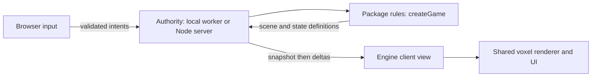

# Mod system design

This document describes the implemented package and session architecture. Read [the API](mod-api.md), [the authoring guide](creating-mods.md), and [Rescue Adventure migration](../src/mods/rescue-adventure/MIGRATION.md) alongside it. The earlier [proposal](mod-system-proposal.md) records the broader direction; this document distinguishes the working implementation from later work.

## The separation

| Layer | Responsibility | Location |
| --- | --- | --- |
| Engine | Chunk storage, voxel meshes, renderer, scene definition renderer, collision controller, fixed simulation ticks, input transport, session replication and persistence | `src/engine/`, existing `src/world.js`, `src/chunk.js`, `src/main.js` and engine services |
| Base game | Minecraft-style blocks, ordinary mobs, survival rules and default world generation | Existing base-game modules in `src/` |
| Packages | Additional definitions, a game’s rules, world templates, presentation definitions and authored assets | One directory per package under `src/mods/` |
| World instances | Seed, selected package/version, player state, mutable campaign state and save data | Browser local save or server `saves/mod-games/<world-id>.json` |

An engine capability is reusable mechanics. A game package decides how those mechanics behave. A world is one instance of that game. Rescue Adventure therefore uses engine blocks and meshing while owning its five biomes, gates, enemies, difficulty, combat progression and rescue story. It does not need a second voxel engine or WebGL application.

The architecture takes Luanti’s engine/game/mod distinction and server-side gameplay model, together with explicit dependency and engine compatibility metadata inspired by Bedrock. It uses JavaScript because this repository already uses JavaScript; it does not embed Lua or reproduce either product’s package format.

Primary references:

- [Luanti engine documentation](https://docs.luanti.org/): the engine hosts separately installed games and content.
- [Luanti dependency management](https://docs.luanti.org/for-creators/mod-dependency-management/): required and optional dependencies affect loading order; unresolved required dependencies prevent loading.
- [Luanti getting started](https://docs.luanti.org/for-players/getting-started/): normal server content reaches clients when they connect.
- [Bedrock manifest reference](https://learn.microsoft.com/minecraft/creator/reference/content/addonsreference/examples/addonmanifest): explicit versions, dependency declarations, module types and minimum engine compatibility.

## Package layout and discovery

```text
src/mods/
  catalog.generated.js          # client entrypoints and map URLs
  games.generated.js            # trusted authority factories
  loader.js                    # lifecycle and scoped API
  registry.js                  # namespaced content ownership
  compatibility.js             # graph and version checks
  rescue-adventure/
    mod.json                   # canonical metadata
    manifest.js                # generated browser/Node representation
    index.js                   # register(api)
    server/game.js             # isolated authoritative rules
    client/ui.html             # scoped presentation template
    client/style.css
    maps/Rescue_Adventure.json  # world template, not a running save
    MIGRATION.md
```

`npm run mods:generate` scans directories containing `mod.json`, validates metadata and referenced files, resolves dependency graphs and emits literal module imports. `npm run dev` and `npm run build` run this automatically. Generated artifacts are checked in so Node tests can import the same catalog without Vite. Do not hand-edit them.

Ordinary engine modules do not import a particular game. The generated loader catalog and trusted authority catalog are the deliberate package entrypoints. Deleting a package and regenerating removes it from the build. Browser discovery cannot read the server filesystem at runtime.

## Identity, compatibility and dependencies

Stable content identities are `namespace:path`. The base-game namespace is currently `minecraft`; a package’s namespace is its manifest `id`. `minecraft:zombie` and `rescue_adventure:zombie` are separate definitions. Inspector labels alone are not identities.

Metadata includes package version, manifest format, engine API range, wire protocol, required capabilities, dependency ranges, authority entrypoint and save schema. Current range syntax is deliberately limited to `*`, exact `1.2.3`, `^1.2.3` and `~1.2.3`. Prereleases, unions and npm-style comparator expressions are unsupported. Required dependencies must exist and match; installed optional dependencies must match as well. Cycles, duplicate identities, unknown capabilities and incompatible API/protocol versions fail before executing entrypoints.

One selected game package may depend on content or extension packages. A world does not combine two unrelated game authorities. New packages must not replace base registries or patch engine prototypes. Registration owns only its package namespace, and cleanup must withdraw all resources it installed.

## Loading and lifetime

1. Discover metadata without executing gameplay.
2. Identify the world’s owner from its map filename or mechanism.
3. Validate the package dependency graph.
4. Load dependencies before the selected package and call `register(api)`.
5. Activate the world’s mechanism. An authoritative game mounts the standard engine view.
6. Start a separate authority factory instance for that world.
7. On world exit, deactivate the view, terminate its worker or disconnect its socket, dispose GPU resources/UI/listeners, unregister content and unload world packages.

All mutable game state belongs inside `createGame(options)`. Module-level mutable state would couple rooms and break replay. Multiple rooms can run the same package with different seeds without sharing HP, enemies, keys or story progression.

Authored campaigns explicitly set `world.generationMode = 'authored'`. Loading or meshing their chunks must not run procedural base terrain. The engine campaign adapter resets streaming before installing tiles; the earlier tournament loading fix likewise prevents pending procedural chunk work from overwriting an authored map. World type and generation policy must be chosen before terrain population.

## Inspector isolation

Every Inspector starts with **Main Game** selected, regardless of the current play world. Its content list uses a core-only query. Selecting a designed world/package changes the query to that package’s metadata, and loads its preview providers only where a preview requires execution. Returning to Main Game unloads those providers and their owned entities. Cleanup matches full content identity/owner rather than a short mob name, so a main-game zombie survives unloading `rescue_adventure:zombie`.

Dependencies can supply runtime content but do not silently appear as content owned by the selected package. Ownership is explicit. A game may reuse `minecraft:stone` without claiming it is `rescue_adventure:stone`. Tournament Host belongs only to `dragonball_tournament`; Rescue guardians belong only to `rescue_adventure`. Items, mobs, blocks and maps remain distinct kinds.

## Authority and multiplayer



Single-device play uses a Web Worker running the same `ModSession` and game factory as the Node host. The main thread renders state and sends intent messages. Local co-op sends independent player-slot inputs to that worker.

Online co-op uses `/ws/mod-games`, provided by a Vite development and preview plugin. Hosting creates a fresh two-player world. The server binds each socket to Mason (slot 0) or Jayden (slot 1); it ignores any claimed slot in a client intent. Only the host can change global menu/story/pause/difficulty state. Damage, drops, gates, AI, movement and victory are calculated on the authority.

The authority ticks at 30 Hz. A join sends package identity/version/hash, content metadata and a complete world/scene snapshot. Subsequent frames contain changed scene nodes, removed IDs and public gameplay/UI state. A late join receives the current full state. The protocol accepts only bounded input packets with increasing sequence numbers. Slow consumers are disconnected so skipped deltas cannot leave a silently corrupted scene. Rejoining requests a new full snapshot.

Rescue Adventure shares progression, food benefits, level, gems and story across its two heroes. Their position, health, ammunition, cooldowns and controls are independent. Local solo remains supported; online rooms always use co-op. A disconnect releases held keys and pauses ticking once the room is empty. Empty rooms expire after one minute; their disk saves can be reopened using the same room code.

## Content distribution and trust

The server sends declarative terrain, entity geometry/transforms, materials, gameplay state and UI state. Clients construct engine meshes from those definitions. Rescue’s procedural models require no separately installed art assets. Its HTML/CSS template is bundled with the application and scoped in a shadow root. The current handshake requires the same bundled game package version and engine API on client and server.

This release loads trusted, build-installed JavaScript packages. It does **not** download and execute arbitrary JavaScript received from a server, provide a hostile-code sandbox, or implement a marketplace installer. A worker isolates state and browser rendering work; it is not a security boundary for untrusted packages. Server packages are reviewed code with Node privileges.

General downloadable texture/audio packs, asset quotas, content-addressed media caching, a fully declarative UI schema, dedicated production hosting and authenticated player identities remain follow-up work. The current same-origin anonymous room codes are suitable for development/private co-op, not an authenticated public service. Do not advertise Bedrock-format compatibility or unrestricted Luanti-style server content installation.

## Persistence

Local **SAVE RUN** records a versioned authority journal in browser storage; **LOAD RUN** reconstructs it. The server saves room journals periodically, on disconnect and on shutdown using temporary-file replacement. Joining an expired saved room restores the journal if its package hash still matches. Saves contain the seed/options, fixed tick count and accepted commands; rendering resources are reconstructed, not serialized GPU objects.

Local saves also carry package identity/version. Bump a package version when changing replay behavior, and supply a migration if old journals should remain usable. The local worker rejects an incompatible package save without stopping the current run.

Journal replay preserves the migrated code’s many interdependent state variables without writing an incomplete hand-maintained snapshot. It is deterministic, but restore cost grows with elapsed ticks. Version 1 limits restored journals to one million ticks and one million entries. Long campaigns should eventually use validated periodic state checkpoints plus later commands. Altered gameplay or engine authority code changes the package hash and requires an explicit save migration; silently continuing with different rules is refused by the server.

## Current migration boundaries

Rescue Adventure uses the new authoritative session contract and shared engine renderer. The Tournament package remains isolated and scoped, but uses its existing browser mechanism API; it has not been converted to the new headless multiplayer authority. The base game’s existing multiplayer/native Java-server connection is a separate system. Neither is implicitly made authoritative by registering a game package. Migrating them should reuse this session boundary rather than mirroring client state and calling that authority.

The current Rescue port uses an engine finite-grid controller for its top-down campaign and reuses engine voxel storage/rendering. It does not force its movement and abilities through the base game’s first-person survival controller. Campaign policies own gates and cage permissions; the engine controller owns swept movement. This allows different games to use shared mechanics without inheriting unsuitable base-game rules.

## Verification

Run `npm run mods:generate`, `npm run test:mods`, `npm run build`, and `node scripts/test-rescue-adventure.mjs` with a dev server on port 3100. The browser script accepts `MOD_INSPECTOR_URL` and an optional `RESCUE_SCREENSHOT` path. Existing `scripts/test-mod-inspectors.mjs` and `scripts/test-tournament-world.mjs` protect previous Inspector and authored-world behavior.

For tests independent of the separate native Minecraft launcher, use `node node_modules/vite/bin/vite.js --config e2e/fixtures/vite.mods.config.js` and set `MOD_INSPECTOR_URL=http://127.0.0.1:3105`. Set `MOD_USE_PICKER=1` against the full dev server to test Designed Worlds → Play World as well. The Rescue browser test exercises menu clicks without pointer lock, local movement/save/resume, two online clients and cleanup. The Inspector script checks both packages and base-only defaults. Restart this fixture after changing server code because HMR is disabled.
